# Diabetes Risk Prediction with Calibrated, Explainable Machine Learning

An end-to-end machine learning project that estimates the **probability that a patient has diabetes** from demographic, clinical and laboratory indicators, and turns those probabilities into **Low / Moderate / High risk groups** to support screening decisions.

The project goes beyond a single accuracy number: it compares models and class-imbalance strategies on a held-out validation set, calibrates the probabilities, picks a clinically motivated decision threshold, evaluates **once** on an untouched test set, explains predictions with **SHAP**, checks performance across **patient subgroups**, and runs an ablation that asks how well risk can be estimated **without blood tests**.

Finally, the models are **externally validated on real patients from NHANES 2021–2023 (CDC)**. That test shows how much of the Kaggle performance survives in real-world data, and exposes a synthetic-data artefact that a single-dataset evaluation would have hidden.

> Portfolio project, developed from a She Code Africa Data Science capstone project and extended into a reproducible, tested ML workflow.

---

## Table of Contents

- [Key Results](#key-results)
- [Visual Results](#visual-results)
- [Explainability](#explainability)
- [Subgroup Analysis](#subgroup-analysis)
- [External Validation on NHANES](#external-validation-on-nhanes)
- [Datasets](#datasets)
- [Methodology](#methodology)
- [Key Insight: Label Leakage from Lab Values](#key-insight-label-leakage-from-lab-values)
- [Repository Structure](#repository-structure)
- [How to Run](#how-to-run)
- [Limitations](#limitations)
- [Future Work](#future-work)
- [Acknowledgements](#acknowledgements)
- [License](#license)

---

## Key Results

**Final model:** class-weighted Gradient Boosting (`HistGradientBoostingClassifier`) + isotonic probability calibration, selected by validation PR-AUC.

Held-out **test set** (14,420 patients, 8.8% with diabetes), at the screening threshold of **0.128** (chosen on validation to reach ≥ 90% sensitivity):

| Metric                     | Test result |
| -------------------------- | ----------: |
| ROC-AUC                    |   **0.977** |
| PR-AUC (average precision) |   **0.880** |
| Brier score                |  **0.0235** |
| Sensitivity (recall)       |   **87.7%** |
| Specificity                |   **92.7%** |
| Precision                  |   **53.9%** |
| Balanced accuracy          |   **90.2%** |

For reference, a model that always predicts the prevalence has PR-AUC 0.088 and Brier 0.080.

### Risk stratification (test set)

| Risk group | Predicted probability | Patients | Observed diabetes | Mean predicted risk | Share of all cases |
| ---------- | --------------------- | -------: | ----------------: | ------------------: | -----------------: |
| Low        | p < 2%                |   10,376 |              0.1% |                0.2% |               1.2% |
| Moderate   | 2% ≤ p < 20%          |    2,603 |              9.5% |                8.9% |              19.5% |
| High       | p ≥ 20%               |    1,441 |             70.0% |               72.1% |              79.3% |

72% of patients are placed in the Low group, which contains only 1.2% of diabetes cases, while the High group (10% of patients) captures 79% of cases. Observed and predicted rates agree closely, so the probabilities can be read at face value.

### Lab-free screening model (ablation)

| Features                    | ROC-AUC | PR-AUC | Sensitivity | Specificity |
| --------------------------- | ------: | -----: | ----------: | ----------: |
| All features                |   0.977 |  0.880 |       87.7% |       92.7% |
| **Without HbA1c & glucose** |   0.827 |  0.308 |       89.3% |       58.7% |

Using only age, BMI, hypertension, heart disease, gender and smoking history, the model still discriminates well above chance (ROC-AUC 0.83). It could work as a cheap **pre-screen** to decide who should get a blood test.

### External validation on real patients (NHANES)

| Model (trained on Kaggle, applied unchanged) | Kaggle test ROC-AUC | NHANES ROC-AUC (diagnosed) | NHANES ROC-AUC (total, ADA) |
| -------------------------------------------- | ------------------: | -------------------------: | --------------------------: |
| Full model                                   |               0.977 |                      0.858 |                       0.891 |
| Lab-free model                               |               0.827 |                      0.775 |                       0.778 |
| _HbA1c alone (benchmark)_                    |                   – |                  **0.929** |                   **0.940** |

On real patients, **HbA1c alone beats the Kaggle-trained model**, because the model learned a rule that exists only in the synthetic data. The lab-free model transfers best. See [External Validation](#external-validation-on-nhanes).

---

## Visual Results

### Model calibration

Isotonic calibration roughly halves the Brier score (0.054 → 0.023) without hurting ranking performance.

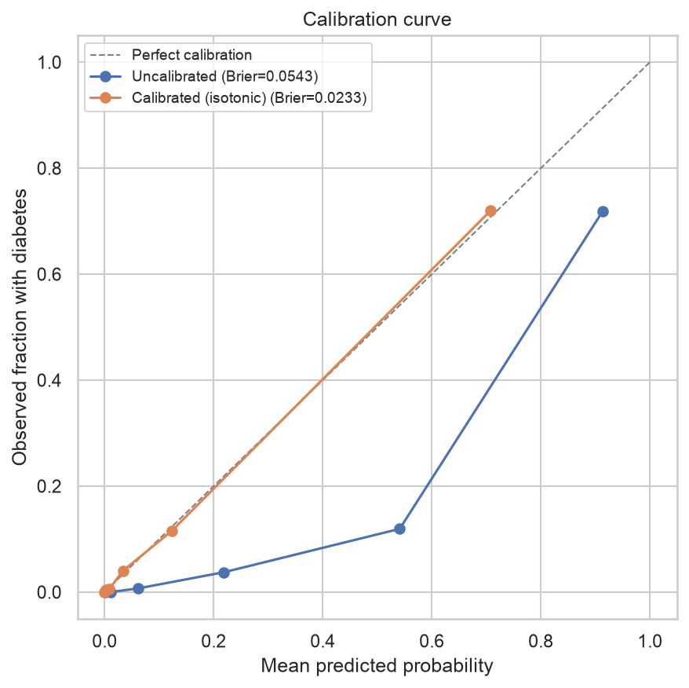

### Risk stratification

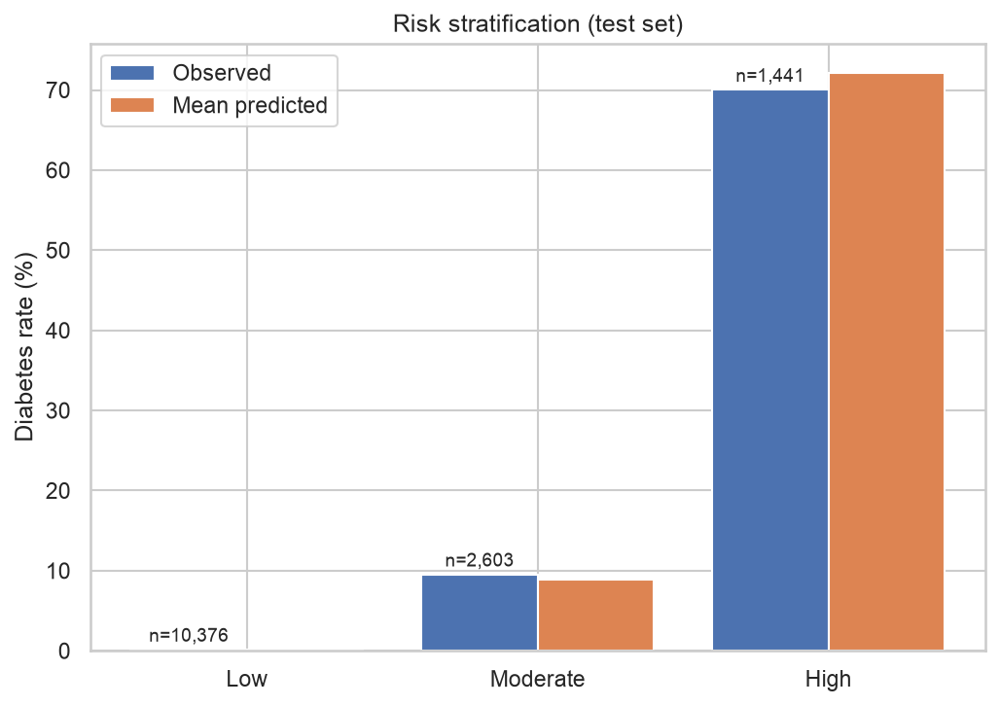

### ROC and precision-recall curves (test set)

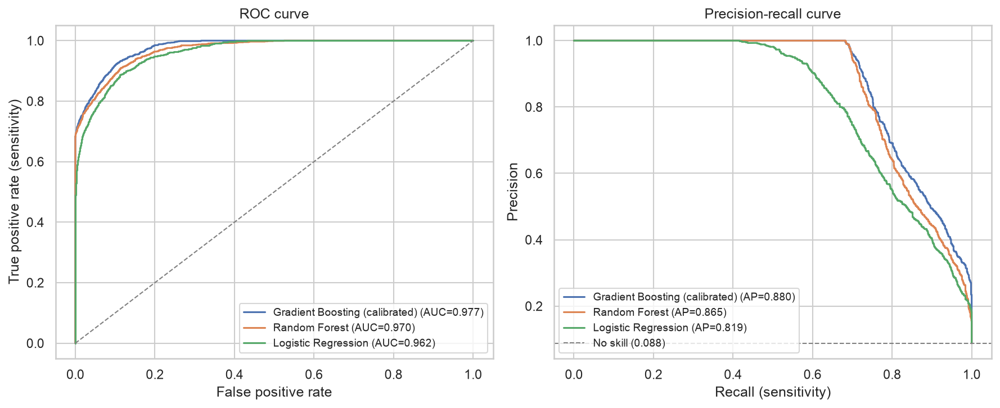

### Threshold choice

The default 0.5 threshold misses about a third of diabetic patients. Lowering it to 0.128 raises sensitivity to around 90%. Each extra positive costs a confirmatory test, not a diagnosis.

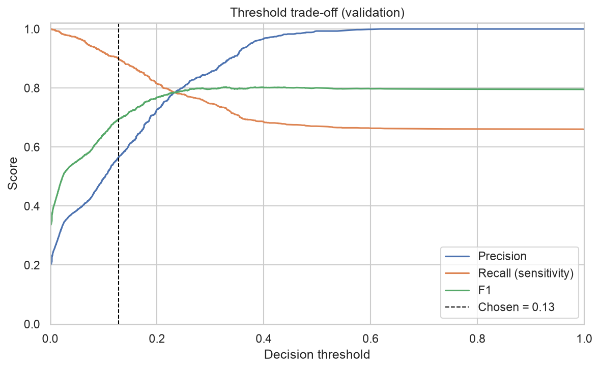
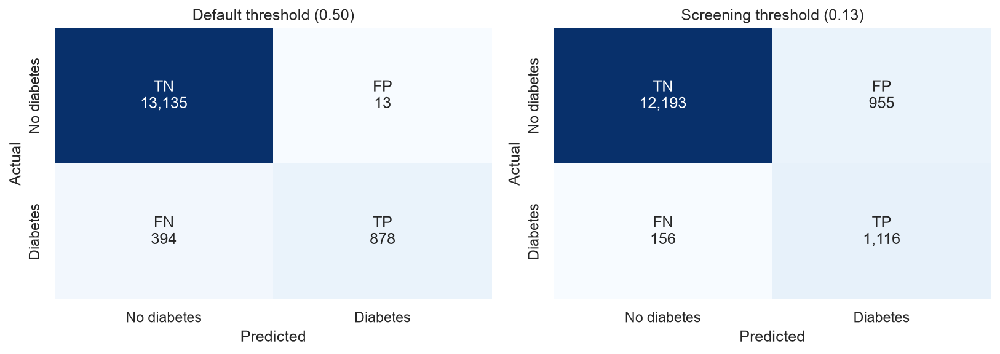

### Decision curve analysis

ROC-AUC measures how well the model ranks patients. Decision curve analysis (Vickers & Elkin, 2006) asks a different question: does acting on the model lead to **better decisions** than the alternatives? For each threshold probability p<sub>t</sub>, it computes the **net benefit**: true positives found, minus false positives weighted by how many unnecessary tests one case is worth.

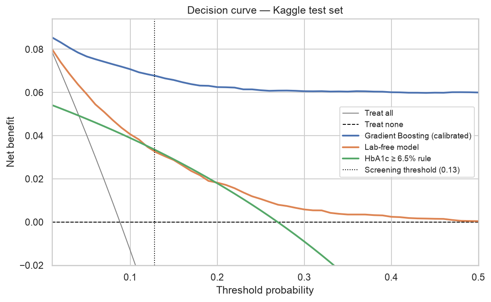

- **On the Kaggle test set, the model gives the most net benefit at every threshold** from 1% to 50%.
- At the screening threshold (≈ 13%) its net benefit is **0.068**, about double the simple "HbA1c ≥ 6.5%" rule (0.033).
- The lab-free model beats testing everyone at every threshold, and beats the HbA1c rule below about 12%.
- The [NHANES decision curve](#external-validation-on-nhanes) tells a more modest story.

---

## Explainability

### Global SHAP importance

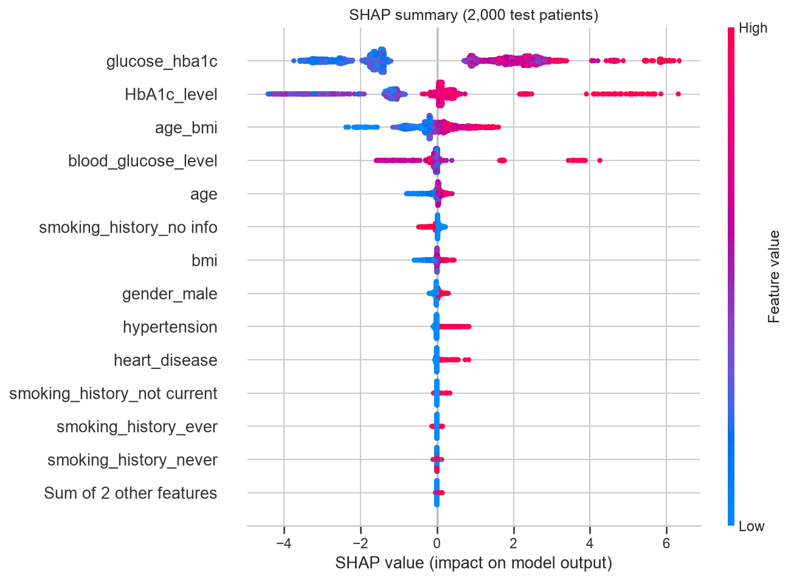

- **Glycaemic markers dominate.** The engineered `glucose_hba1c` interaction and `HbA1c_level` contribute most, which permutation importance confirms.
- The HbA1c dependence plot shows **step changes at the clinical diagnostic thresholds**.
- **Age and BMI** matter mainly through their interaction (`age_bmi`). Hypertension, heart disease, gender and smoking make small adjustments.

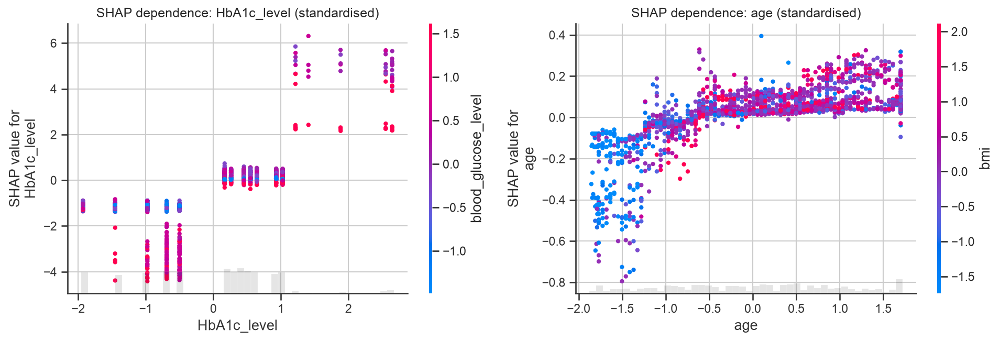
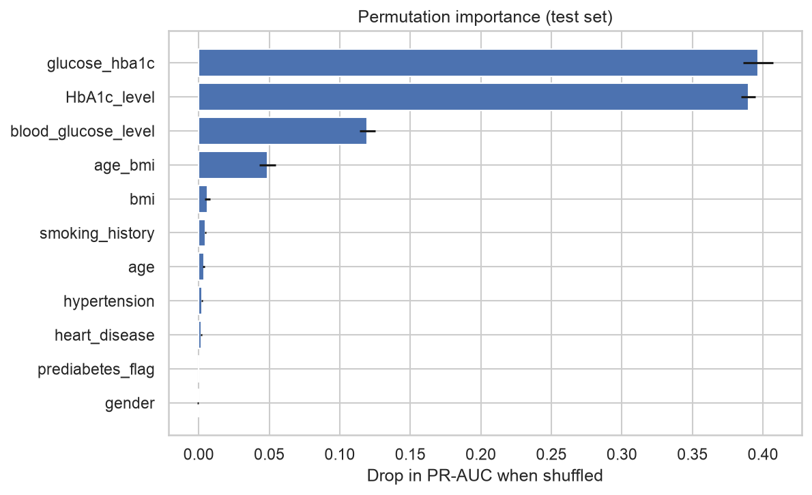

### Local explanations

Each prediction can be broken down into feature contributions. The example below is a **high-risk** patient whose HbA1c (6.0%) and glucose (130 mg/dL) are only borderline. Age 62, BMI 44.8, hypertension and heart disease push the risk to 73%.

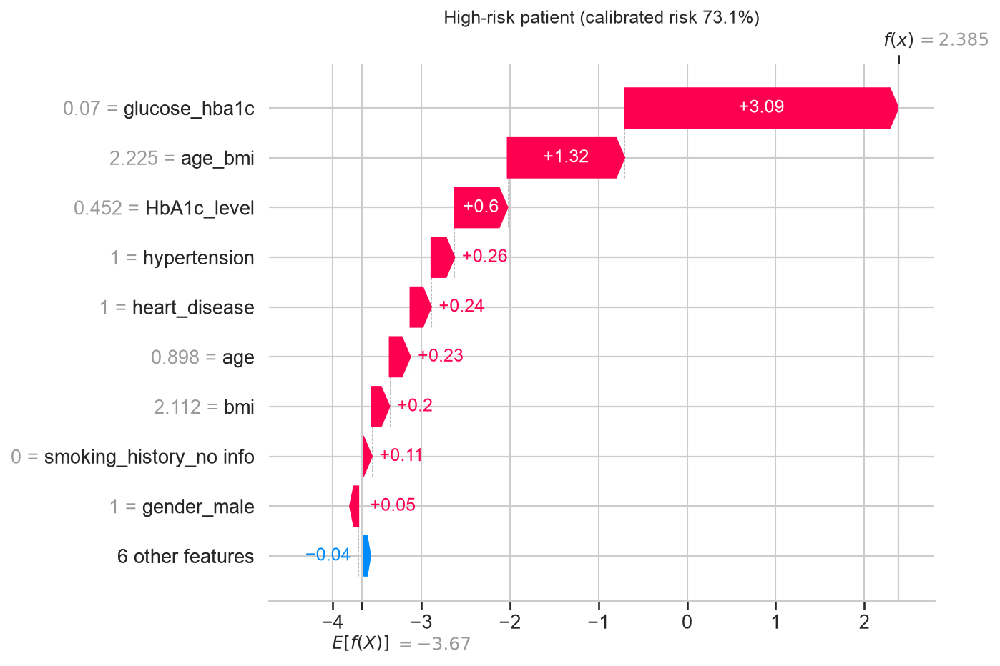

Low- and moderate-risk examples: [`shap_waterfall_low_risk.png`](reports/figures/shap_waterfall_low_risk.png), [`shap_waterfall_moderate_risk.png`](reports/figures/shap_waterfall_moderate_risk.png).

### Transparent reference model

Logistic regression odds ratios (per standard deviation) give an interpretable cross-check: [`lr_odds_ratios.png`](reports/figures/lr_odds_ratios.png).

---

## Subgroup Analysis

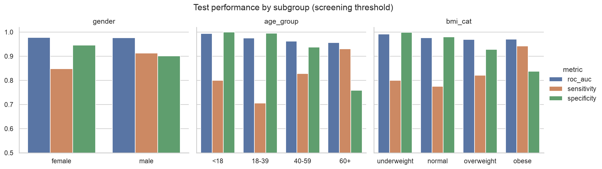

- ROC-AUC stays at or above 0.95 for every gender, age group and BMI category.
- **Sensitivity is lower in younger (18–39) and normal-BMI patients**, where diabetes is rare.
- **Specificity is lower in patients aged 60+ and obese patients**, who more often have borderline lab values.

Group-specific thresholds or external validation would be needed before any real-world use.

---

## External Validation on NHANES

The Kaggle dataset's origins are unclear, so the trained models were tested on **NHANES 2021–2023** ([notebook 05](notebooks/05_external_validation_nhanes.ipynb)). NHANES is the CDC's nationally representative survey, and it **measures HbA1c and fasting glucose**. The models were applied exactly as trained, with the same thresholds and risk cut-offs.

- **Cohorts:** 3,158 adults with HbA1c and fasting glucose, for the full model. 5,943 adults with complete non-lab data, for the lab-free model.
- **Outcomes:** two definitions.
  - **Diagnosed:** self-reported doctor diagnosis. This doesn't depend on the lab values, which makes it the honest test.
  - **Total (ADA):** diagnosed, or HbA1c ≥ 6.5%, or fasting glucose ≥ 126 mg/dL.

| Full model at Kaggle threshold | Kaggle test | NHANES diagnosed | NHANES total (ADA) |
| ------------------------------ | ----------: | ---------------: | -----------------: |
| ROC-AUC                        |       0.977 |            0.858 |              0.891 |
| ROC-AUC (survey-weighted)      |           – |            0.880 |              0.906 |
| PR-AUC                         |       0.880 |            0.641 |              0.819 |
| Sensitivity                    |       87.7% |            73.6% |              73.7% |
| Specificity                    |       92.7% |            94.0% |              98.7% |

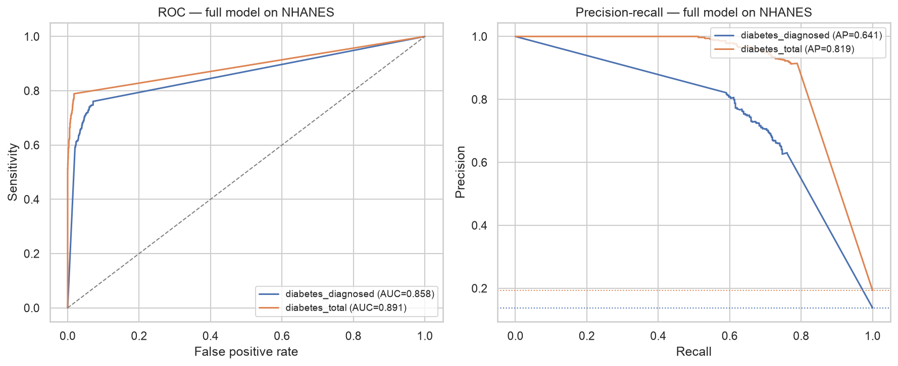

### The glucose-126 artefact

In the Kaggle data, **not one diabetic patient has glucose below 126 mg/dL**, so the model learned "glucose < 126 ⇒ not diabetic" as a hard rule. Real patients don't follow it:

| NHANES diagnosed diabetics | Patients | Median HbA1c | Median predicted risk | Sensitivity |
| -------------------------- | -------: | -----------: | --------------------: | ----------: |
| Fasting glucose < 126      |      157 |         6.2% |                    0% |       34.4% |
| Fasting glucose ≥ 126      |      278 |         7.6% |                  100% |       95.7% |

That is the long flat stretch in the ROC curve above: about a fifth of the real diabetics get a predicted risk of exactly 0.

### What this means

1. **A 0.98 AUC on one dataset can be misleading.** On real patients the model is still good (AUC 0.86–0.89), but it is **worse than HbA1c alone (0.93)**.
2. **Calibration doesn't transfer either.** Mean predicted risk is 12% against an observed 19%, so the model would need recalibrating locally before any use.
3. **The lab-free model generalises best** (AUC 0.83 → 0.78). It relies on genuine risk factors (age, BMI, hypertension, heart disease), not synthetic cut-offs.
4. **Next step:** train on real data (pooled NHANES cycles) instead of the Kaggle data.

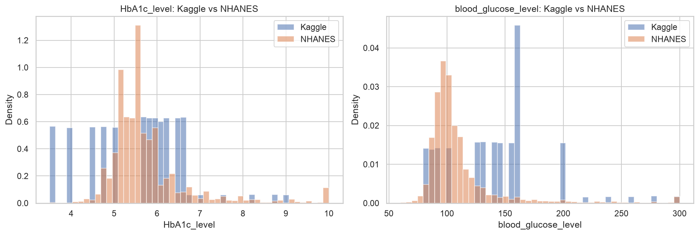

### Decision curve on NHANES

Is the model still useful for real decisions? This uses the honest outcome, self-reported diagnosis.

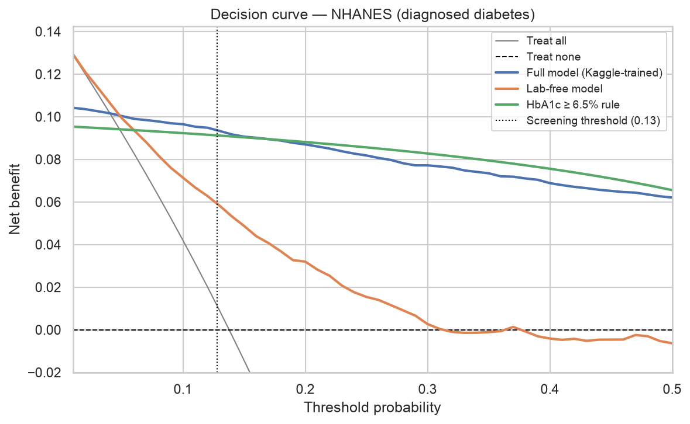

| Net benefit at threshold probability | 5%    | 10%   | 13% (screening) | 20%   |
| ------------------------------------ | ----- | ----- | --------------- | ----- |
| Full model (Kaggle-trained)          | 0.100 | 0.097 | 0.093           | 0.087 |
| HbA1c ≥ 6.5% rule                    | 0.094 | 0.092 | 0.091           | 0.088 |
| Lab-free model                       | 0.099 | 0.071 | 0.058           | 0.032 |
| Test everyone                        | 0.092 | 0.042 | 0.009           | < 0   |

- **From about 5% to 17%**, the model gives the most net benefit, but **only just more than the HbA1c test alone**. On Kaggle it was twice as good.
- **Above about 17%**, the HbA1c rule wins.
- **Below about 5%**, when a missed case matters far more than an extra test, the lab-free model and "test everyone" do better. The glucose-126 artefact costs the full model the cases it scores at 0%.

---

## Datasets

**Training and internal testing:** [Diabetes Prediction Dataset](https://www.kaggle.com/datasets/iammustafatz/diabetes-prediction-dataset) (Kaggle). 100,000 patient records, 8 predictors and a binary `diabetes` label.

**External validation:** [NHANES 2021–2023](https://wwwn.cdc.gov/nchs/nhanes/continuousnhanes/default.aspx?Cycle=2021-2023) (CDC / NCHS, public domain). The files are downloaded automatically by notebook 05.

See [`data/README.md`](data/README.md) for column dictionaries, the variable mapping and download steps.

| Group          | Features                                       |
| -------------- | ---------------------------------------------- |
| Demographic    | `gender`, `age`                                |
| Comorbidities  | `hypertension`, `heart_disease`                |
| Lifestyle      | `smoking_history`                              |
| Anthropometric | `bmi`                                          |
| Laboratory     | `HbA1c_level`, `blood_glucose_level`           |
| Engineered     | `age_bmi`, `glucose_hba1c`, `prediabetes_flag` |

After cleaning: **96,128 patients**, of whom **8.8%** have diabetes.

---

## Methodology

```
raw CSV ─► clean ─► engineer features ─► stratified split (70 / 15 / 15)
                                              │
            ┌─────────────────────────────────┘
            ▼
  imblearn Pipeline: IQR capping → scaling / one-hot → [SMOTE] → classifier
            │
            ├─► compare 3 models × 3 imbalance strategies on VALIDATION (PR-AUC)
            ├─► isotonic calibration (5-fold CV on train)
            ├─► threshold for ≥ 90% sensitivity on VALIDATION
            ├─► single final evaluation on TEST ─► risk groups, decision curves, SHAP, subgroups
            └─► external validation on NHANES 2021–2023 (models applied unchanged)
```

1. **Exploration** ([01](notebooks/01_data_exploration.ipynb)): data quality, class imbalance, risk-factor profiles, correlations.
2. **Preparation** ([02](notebooks/02_data_preparation.ipynb)):
   - Removed 3,854 duplicate rows and 18 `gender = Other` rows, which had no positive cases.
   - Kept `No Info` smoking as its own category.
   - Engineered the interaction features.
   - Made a three-way stratified split.
   - Built leakage-safe preprocessing: outlier caps, scaling and SMOTE are all fitted on training data only, inside the pipeline.
3. **Modelling** ([03](notebooks/03_model_development.ipynb)): three models (Logistic Regression, Random Forest and Gradient Boosting), each trained three ways (unweighted, class-weighted and SMOTE), plus a prior-only baseline. The best model is calibrated, its threshold is tuned, it is tested once, and then the decision curve and no-lab ablation are run.
4. **Explainability** ([04](notebooks/04_explainability.ipynb)): logistic regression odds ratios, permutation importance, SHAP (global, dependence, waterfall) and subgroup metrics.
5. **External validation** ([05](notebooks/05_external_validation_nhanes.ipynb)): the NHANES data are mapped onto the Kaggle columns. Both trained models are then applied unchanged, alongside lab-only benchmarks, survey-weighted AUCs, an analysis of the glucose artefact and a decision curve.

### Validation model comparison (default 0.5 threshold)

| Model                 | Strategy           |   ROC-AUC |    PR-AUC |     Brier | Sensitivity | Precision |
| --------------------- | ------------------ | --------: | --------: | --------: | ----------: | --------: |
| **Gradient Boosting** | **Class-weighted** | **0.981** | **0.893** |     0.054 |       92.0% |     50.3% |
| Gradient Boosting     | Unweighted         |     0.980 |     0.891 | **0.023** |       67.3% |     98.2% |
| Random Forest         | Class-weighted     |     0.977 |     0.880 |     0.035 |       80.5% |     69.4% |
| Random Forest         | Unweighted         |     0.976 |     0.879 |     0.024 |       67.3% |     98.3% |
| Logistic Regression   | Unweighted         |     0.967 |     0.835 |     0.031 |       63.1% |     87.8% |
| Logistic Regression   | SMOTE              |     0.967 |     0.832 |     0.075 |       89.6% |     44.1% |
| Baseline (prior)      | –                  |     0.500 |     0.088 |     0.080 |          0% |         – |

Class weighting and SMOTE change ranking quality very little. Their main effect is to push probabilities upward, which trades precision and calibration for sensitivity. This project gets the same trade-off more transparently by **calibrating and then moving the threshold**.

### Improvements over the original capstone

| Original capstone                                           | This version                                                       |
| ----------------------------------------------------------- | ------------------------------------------------------------------ |
| Single train/test split; the test set informed model choice | Train / validation / test; the test set is used once               |
| SMOTE applied manually before fitting                       | SMOTE inside an `imblearn` pipeline (no leakage)                   |
| Accuracy-led comparison at a 0.5 threshold                  | PR-AUC, Brier score, calibration, a clinically chosen threshold and decision curve analysis |
| LR vs RF                                                    | LR, RF and Gradient Boosting × 3 imbalance strategies + baseline   |
| Feature importance only                                     | SHAP (global and local), permutation importance, subgroup analysis |
| Evaluated on one dataset only                               | External validation on real NHANES patients                        |
| Single notebook                                             | Modular `src/` package, 5 notebooks, unit tests, CI                |

---

## Key Insight: Label Leakage from Lab Values

EDA shows the label is **partly determined by the lab values**:

- No patient with HbA1c < 5.7% or glucose < 126 mg/dL is labelled diabetic.
- Every patient with HbA1c ≥ 6.8% or glucose ≥ 220 mg/dL is.

These cut-offs are essentially the clinical diagnostic criteria. Part of the model's very high ROC-AUC therefore comes from **re-learning the diagnostic rule**, not from predicting future disease. I report this openly and quantify it with the lab-free ablation above, rather than presenting 0.98 AUC as a headline without context.

The [NHANES external validation](#external-validation-on-nhanes) confirms this: on real patients, the rule the model learned from these cut-offs costs it accuracy.

---

## Repository Structure

```
diabetes-risk-prediction/
├── data/
│   ├── README.md               # dataset sources, download steps, column dictionaries
│   ├── raw/                    # place diabetes_prediction_dataset.csv here (git-ignored)
│   └── external/nhanes/        # NHANES files, downloaded by notebook 05 (git-ignored)
├── notebooks/
│   ├── 01_data_exploration.ipynb
│   ├── 02_data_preparation.ipynb
│   ├── 03_model_development.ipynb
│   ├── 04_explainability.ipynb
│   ├── 05_external_validation_nhanes.ipynb
│   └── _build_notebooks.py     # regenerates the notebooks from source
├── src/
│   ├── config.py               # paths and constants
│   ├── data_preparation.py     # load, clean, feature engineering, split
│   ├── preprocessing.py        # IQRCapper + ColumnTransformer
│   ├── modeling.py             # models, imbalance strategies, calibration, thresholds
│   ├── evaluation.py           # metrics, risk groups, plots
│   ├── explainability.py       # odds ratios, permutation importance, SHAP
│   └── nhanes.py               # NHANES download, harmonisation, cohorts
├── tests/                      # pytest unit tests (synthetic data, no download needed)
├── reports/
│   ├── figures/                # all figures used in this README
│   ├── metrics.json            # final test metrics and risk-group table
│   ├── metrics_nhanes.json     # external validation results
│   ├── decision_curve_*.csv    # net benefit by threshold (Kaggle test, NHANES)
│   └── validation_model_comparison.csv
├── .github/workflows/tests.yml # CI: runs the test suite on every push
├── requirements.txt
└── requirements-lock.txt       # exact versions used to produce the results
```

---

## How to Run

Requires Python 3.11 or later.

```bash
git clone https://github.com/kaempy/diabetes-risk-prediction.git
cd diabetes-risk-prediction
python -m venv .venv && source .venv/bin/activate
pip install -r requirements.txt
```

Download the Kaggle dataset into `data/raw/` (see [`data/README.md`](data/README.md)). Then run the notebooks in order, `01` → `05`:

- Notebook 03 saves the trained models to `models/` and the metrics to `reports/`.
- Notebooks 04 and 05 load those models.
- Notebook 05 downloads the NHANES files (about 10 MB) the first time it runs.

To run all the notebooks headlessly:

```bash
cd notebooks && jupyter nbconvert --to notebook --execute --inplace 0*.ipynb
```

To run the tests:

```bash
pytest
```

The full pipeline takes about 4 minutes on a laptop. All randomness is seeded (`random_state=42`), and results reproduce exactly with `requirements-lock.txt`.

---

## Limitations

- **Dataset provenance.** The Kaggle dataset has limited documentation. Lab values take only 18 distinct levels each, which suggests synthetic or heavily rounded data. Results may not transfer to real clinical populations.
- **Diagnostic leakage.** HbA1c and glucose overlap with the definition of the label (see above).
- **Cross-sectional data.** The model estimates _current_ diabetes status, not future onset.
- **Small subgroups.** Under-18s have about 10 test cases, and the `gender = Other` group was removed.
- **Transfer to real data.** On NHANES, the full model falls behind HbA1c alone, and its probabilities are mis-calibrated (see [External Validation](#external-validation-on-nhanes)).
- **Validation shortcuts.** NHANES glucose is fasting, while the Kaggle measure is probably random. The survey-weighted AUCs are point estimates without design-based confidence intervals.

## Future Work

- Retrain on real data (pooled NHANES cycles), using survey weights and including treatment status.
- Build a dedicated **lab-free model** with richer lifestyle and family-history features.
- Tune hyperparameters with nested cross-validation.
- Serve the model behind a small API or Streamlit app with per-patient SHAP explanations.

---

## Acknowledgements

This project began as the **She Code Africa Data Science capstone (Group 1)**. The original team carried out the initial data cleaning, EDA, feature engineering, and the logistic regression and random forest models. This repository restructures and extends that work.

Datasets:

- Mohammed Mustafa, _Diabetes Prediction Dataset_, Kaggle.
- Centers for Disease Control and Prevention, National Center for Health Statistics. _National Health and Nutrition Examination Survey 2021–2023_. U.S. Department of Health and Human Services.

---

## License

The code in this repository is released under the [MIT License](LICENSE). The datasets are not covered by this licence: the Kaggle dataset is subject to its own terms on Kaggle, and NHANES data are public domain (CDC / NCHS).

---

**Author:** _Adebanjo Mary_ · [LinkedIn](https://www.linkedin.com/in/adebanjo-abolanle-mary) · [GitHub](https://github.com/kaempy)
